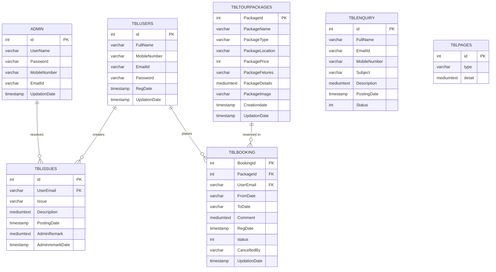
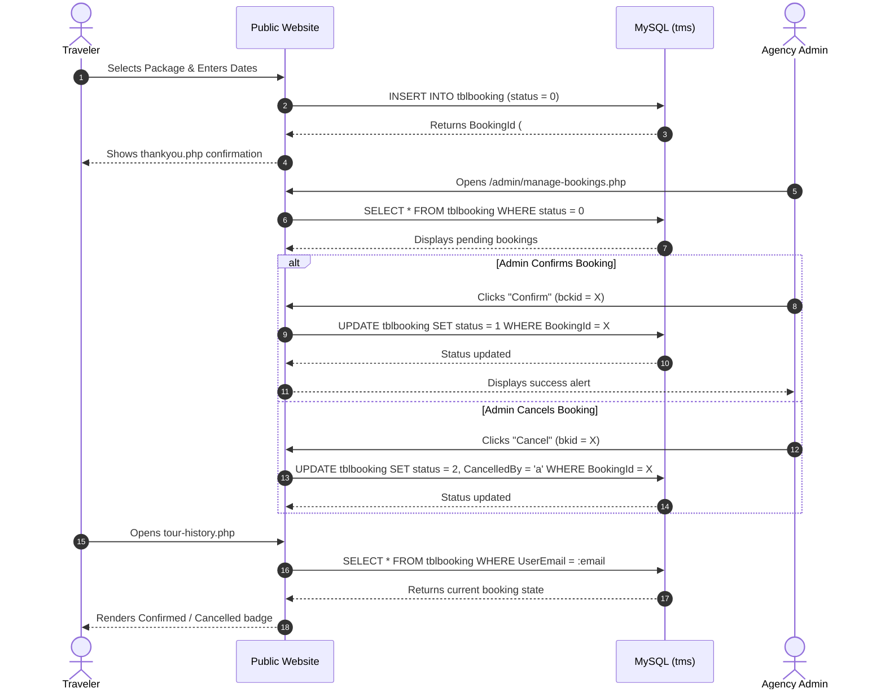
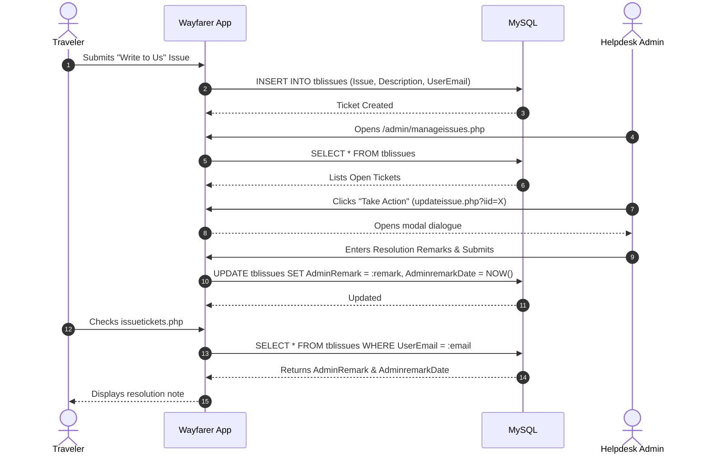

# Wayfarer — Complete Architectural & Technical Reference (A to Z)

---

## Table of Contents
1. [Project Overview & Domain Concepts](#1-project-overview--domain-concepts)
2. [Complete Technology Stack](#2-complete-technology-stack)
3. [Full Inventory of Libraries & Assets](#3-full-inventory-of-libraries--assets)
4. [Architecture & Request Lifecycle](#4-architecture--request-lifecycle)
5. [Database Architecture & Schema Dictionary](#5-database-architecture--schema-dictionary)
6. [Comprehensive Module Walkthrough](#6-comprehensive-module-walkthrough)
   - [6.1 Authentication & Traveler Accounts](#61-authentication--traveler-accounts)
   - [6.2 Tour Package Catalog & Booking Engine](#62-tour-package-catalog--booking-engine)
   - [6.3 Customer Support & Ticketing Lifecycle](#63-customer-support--ticketing-lifecycle)
   - [6.4 Inquiries & Communications](#64-inquiries--communications)
   - [6.5 Administrative Command Center & KPIs](#65-administrative-command-center--kpis)
   - [6.6 Content Management System (CMS)](#66-content-management-system-cms)
7. [Visual Workflows & Sequence Diagrams](#7-visual-workflows--sequence-diagrams)
8. [Complete File-by-File Codebase Map](#8-complete-file-by-file-codebase-map)
9. [Local Development, PowerShell Tooling & Deployment](#9-local-development-powershell-tooling--deployment)
10. [Security Model, Hardening & Production Roadmap](#10-security-model-hardening--production-roadmap)
11. [Troubleshooting & Frequently Asked Questions](#11-troubleshooting--frequently-asked-questions)

---

## 1. Project Overview & Domain Concepts

**Wayfarer** is a monolithic, server-rendered web application engineered to power an end-to-end travel agency and holiday package reservation platform. The system caters to two primary user personas:

1. **Travelers (Public Customers):** Individuals looking for vacation packages, seeking destinations, checking package inclusions and pricing, making online reservations, tracking booking status, and submitting customer support tickets.
2. **Travel Administrators (Operations & Agency Staff):** Internal team members responsible for maintaining the catalog of tour packages, approving or rejecting traveler reservations, answering inquiries, resolving customer tickets, and modifying informational content (Terms, Privacy Policy, About Us).

### Key Business Workflows
- **Package Discovery:** Categorized packages (e.g., Couple Packages, Family Packages, Group Tours) with location tags, detailed itinerary notes, pricing in USD, and photo galleries.
- **Self-Service Reservation:** Travelers select departure (`FromDate`) and return (`ToDate`) dates, add special requests or passenger notes, and submit reservations without requiring immediate payment gateway integration.
- **Booking Auditing:** Bookings transition through a deterministic state machine: `0` (Pending/New), `1` (Confirmed by Admin), or `2` (Cancelled). Cancellations capture whether the action was initiated by traveler (`u`) or administrator (`a`), with timestamp tracking.
- **Direct Support Ticketing:** Instead of external email reliance, travelers create tracked support tickets (`tblissues`) associated with their account and view administrative remarks in real time.

---

## 2. Complete Technology Stack

```
+-------------------------------------------------------------------+
|                        PRESENTATION LAYER                         |
|  HTML5 * CSS3 * Bootstrap 3.3.6 * Font Awesome 4.7 * jQuery 1.12  |
|         WOW.js (Animations) * BasicTable * NicEdit (CMS)          |
+-------------------------------------------------------------------+
                                 |
                                 v
+-------------------------------------------------------------------+
|                        APPLICATION LAYER                          |
|                       PHP 8.2+ (ZTS/NTS)                          |
|   - Native Session Authentication ($_SESSION)                     |
|   - Server-Side Rendering (SSR) & Output Buffering                |
|   - Parameterized PDO Prepared Statements                         |
|   - Multipart/Form-Data File Upload Handlers                      |
+-------------------------------------------------------------------+
                                 |
                                 v
+-------------------------------------------------------------------+
|                           DATA LAYER                              |
|                    MySQL 5.7+ / MariaDB 10.4+                     |
|   - Database: tms                                                 |
|   - Character Set: utf8mb4 / latin1                               |
|   - Engine: InnoDB (Transactions, Auto-Increment)                 |
+-------------------------------------------------------------------+
```

### 1. Backend Runtime: PHP
- **Version Compatibility:** PHP 8.2, 8.3, and 8.4.
- **Extensions Utilized:**
  - `pdo`: PHP Data Objects database abstraction layer.
  - `pdo_mysql`: MySQL driver for PDO.
  - `session`: Native cookie-based session management across HTTP requests.
  - `standard` / `core`: Array manipulation, string formatting, date formatting, and `move_uploaded_file()` for image uploads.

### 2. Database: MySQL / MariaDB
- **Engine:** InnoDB storage engine providing ACID compliance and row-level locking.
- **Dialect:** Standard ANSI SQL with MySQL extensions (prepared statement parameter markers `:named_params`).
- **Connection Protocol:** TCP/IP socket on loopback (`127.0.0.1:3306` or `127.0.0.1:3307`).

### 3. Frontend Architecture: Responsive Multi-Page Application (MPA)
- **Responsive Framework:** Twitter Bootstrap with a custom 12-column responsive grid layout.
- **Iconography:** Font Awesome 4.7.0 scalable vector icons alongside Bootstrap Glyphicons.
- **Typography:**
  - Modern Admin & Brand Font: *Plus Jakarta Sans* (via Google Fonts).
  - Public & Dashboard Body: *Roboto* and *Montserrat*.
- **Client Scripting:** jQuery 1.12.0 (Public portal) and jQuery 2.1.4 (Admin panel).

---

## 3. Full Inventory of Libraries & Assets

Below is the verified inventory of all third-party libraries and scripts actively bundled in the codebase:

| Library / Asset | File Path | Version | Purpose in Wayfarer |
| :--- | :--- | :--- | :--- |
| **Bootstrap (CSS/JS)** | `css/bootstrap.css`, `js/bootstrap.min.js`, `admin/css/bootstrap.min.css`, `admin/js/bootstrap.min.js` | 3.3.6 | Provides the grid layout system, responsive modal dialogs (sign-in/sign-up modals), navigation bars, and form controls. |
| **jQuery** | `js/jquery-1.12.0.min.js`, `admin/js/jquery-2.1.4.min.js` | 1.12.0 / 2.1.4 | DOM querying, event handling, AJAX requests for dynamic email checking, and Bootstrap modal toggling. |
| **Font Awesome** | `css/font-awesome.css`, `admin/css/font-awesome.css`, `fonts/*`, `admin/fonts/*` | 4.7.0 | Vector iconography for navigation items, action buttons (cancel, edit, confirm, print), social links, and statistics cards. |
| **WOW.js** | `js/wow.min.js`, `css/animate.css` | 1.1.2 | Triggers smooth CSS animations as travelers scroll through the home page and package listings. |
| **BasicTable** | `admin/css/basictable.css`, `admin/css/table-style.css`, `admin/js/jquery.basictable.min.js` | 1.0.2 | Converts tabular booking, user, and enquiry tables into touch-friendly accordion cards on mobile screen widths (< 768px). |
| **jQuery NiceScroll** | `admin/js/jquery.nicescroll.js` | 3.5.0 | Provides smooth, customized scrollbar rendering in the administrative control panel. |
| **NicEdit** | `admin/nicEdit.js`, `admin/nicEditorIcons.gif` | 0.9r23 | Lightweight in-browser WYSIWYG rich text editor used in `manage-pages.php` to format HTML content for static pages. |
| **Raphael & Morris** | `admin/js/raphael-min.js`, `admin/js/morris.js`, `admin/css/morris.css` | 0.5.1 | Vector charting library dependencies bundled for administrative data visualization. |

---

## 4. Architecture & Request Lifecycle

Wayfarer employs a pragmatic, server-rendered architecture where each PHP file represents a cohesive controller and view pair.

### Detailed Request Execution Cycle
```
Browser Request
      │
      ▼
1. PHP Session Initialized
   session_start();
      │
      ▼
2. Unified Database Configuration Loaded
   include('includes/config.php');
   - Checks environment variables (TMS_DB_HOST, TMS_DB_PORT, etc.)
   - Checks ignored config.local.php
   - Falls back to standard localhost credentials
   - Instantiates: new PDO("mysql:host=...;dbname=...", $user, $pass)
      │
      ▼
3. Access Control & Authorization Guard
   - Public pages: Checks if $_SESSION['login'] exists for protected actions.
   - Admin pages: Verifies strlen($_SESSION['alogin']) > 0; redirects to index.php if absent.
      │
      ▼
4. Form Processing & Business Logic (POST/GET)
   - Input extraction and type casting (e.g. $bid = intval($_GET['bkid']))
   - Prepared statement creation: $query = $dbh->prepare($sql)
   - Explicit parameter binding: $query->bindParam(':param', $var, PDO::PARAM_STR)
   - Execution & error state capture ($msg or $error)
      │
      ▼
5. Output Rendering
   - Includes header.php (Navigation, brand identity, account status)
   - Emits HTML content with htmlentities() escaping
   - Includes footer.php (Copyrights, closing tags, scripts)
      │
      ▼
HTTP 200 OK + Rendered HTML delivered to browser
```

---

## 5. Database Architecture & Schema Dictionary

The system uses a single database, typically named `tms`. All tables use InnoDB for transaction safety and referential integrity.

### Entity-Relationship Overview



---

### Detailed Table Specifications

#### 1. `admin`
Stores system administrator credentials.
- `id` (int, Primary Key, Auto Increment): Administrator ID.
- `UserName` (varchar 100): Login username (e.g. `admin`).
- `Password` (varchar 100): Password string (stored as MD5 hash or plain-text fallback).
- `MobileNumber` (char 10): Contact mobile number for account recovery.
- `EmailId` (varchar 100): Official email address.
- `UpdationDate` (timestamp): Last profile or password update time.

#### 2. `tblusers`
Stores registered customer/traveler accounts.
- `id` (int, Primary Key, Auto Increment): User identifier.
- `FullName` (varchar 100): Traveler's real name.
- `MobileNumber` (char 10): 10-digit mobile phone number.
- `EmailId` (varchar 70, Indexed): Unique email used as customer login username.
- `Password` (varchar 100): Customer password hash (MD5).
- `RegDate` (timestamp): Account registration date.
- `UpdationDate` (timestamp): Account modification date.

#### 3. `tbltourpackages`
The catalog of holiday trips available for booking.
- `PackageId` (int, Primary Key, Auto Increment): Package ID.
- `PackageName` (varchar 200): Public title (e.g., *Swiss Paris Delight Premium*).
- `PackageType` (varchar 150): Tag such as *Family Package*, *Couple Package*, or *Group Tour*.
- `PackageLocation` (varchar 100): Destination country or city.
- `PackagePrice` (int): Price per traveler in USD.
- `PackageFetures` (varchar 255): Comma-separated highlights (e.g. *Free Wi-Fi, Breakfast, Airport Drop*).
- `PackageDetails` (mediumtext): Full descriptive itinerary and terms.
- `PackageImage` (varchar 100): Filename stored under `admin/pacakgeimages/`.
- `Creationdate` (timestamp): Date package was added.
- `UpdationDate` (timestamp): Last modified timestamp.

#### 4. `tblbooking`
Tracks all reservations made by travelers.
- `BookingId` (int, Primary Key, Auto Increment): Unique reservation code (formatted as `#BK-1`).
- `PackageId` (int): References `tbltourpackages.PackageId`.
- `UserEmail` (varchar 100): References `tblusers.EmailId`.
- `FromDate` (varchar 100): Departure date string (formatted as `YYYY-MM-DD`).
- `ToDate` (varchar 100): Return date string (formatted as `YYYY-MM-DD`).
- `Comment` (mediumtext): Special requests, traveler count, dietary restrictions.
- `RegDate` (timestamp): When reservation was created.
- `status` (int, Default `0`):
  - `0`: Pending / Under Review.
  - `1`: Confirmed by Agency.
  - `2`: Cancelled.
- `CancelledBy` (varchar 5):
  - `'u'`: Cancelled by Traveler.
  - `'a'`: Cancelled by Administrator.
- `UpdationDate` (timestamp): Date the booking status was last changed.

#### 5. `tblissues`
Customer support and helpdesk tickets.
- `id` (int, Primary Key, Auto Increment): Ticket ID.
- `UserEmail` (varchar 100): Traveler email.
- `Issue` (varchar 100): Categorized topic (e.g. *Booking Cancellation*, *Refund*, *Itinerary Change*).
- `Description` (mediumtext): Traveler inquiry or complaint.
- `PostingDate` (timestamp): Date ticket was submitted.
- `AdminRemark` (mediumtext): Agency response or resolution details.
- `AdminremarkDate` (timestamp): Timestamp when administrator answered the ticket.

#### 6. `tblenquiry`
General contact inquiries submitted from the website landing page or inquiry form.
- `id` (int, Primary Key, Auto Increment): Inquiry ID.
- `FullName` (varchar 100): Sender name.
- `EmailId` (varchar 100): Sender email address.
- `MobileNumber` (char 10): Sender phone number.
- `Subject` (varchar 100): Purpose of inquiry.
- `Description` (mediumtext): Message body.
- `PostingDate` (timestamp): Submission timestamp.
- `Status` (int): `0` or `NULL` (New/Unread), `1` (Read).

#### 7. `tblpages`
Content Management System (CMS) storage for static legal and informational pages.
- `id` (int, Primary Key, Auto Increment): Page entry ID.
- `type` (varchar 50): Key identifier (`terms`, `privacy`, `aboutus`, `contact`).
- `detail` (mediumtext): Rich HTML page content edited via NicEdit in the admin panel.

---

## 6. Comprehensive Module Walkthrough

### 6.1 Authentication & Traveler Accounts
- **Registration (`includes/signup.php`):**
  A Bootstrap modal form collects traveler name, phone, email, and password. It triggers an AJAX `onBlur` event hitting `check_availability.php`, which executes:
  ```sql
  SELECT EmailId FROM tblusers WHERE EmailId = :email
  ```
  If an existing record matches, the form immediately warns the user in red text and disables submission.
- **Login (`includes/signin.php`):**
  Accepts email and password, executes an MD5-hashed lookup against `tblusers`, and upon a match sets:
  ```php
  $_SESSION['login'] = $_POST['email'];
  ```
- **Profile Management (`profile.php`):**
  Allows travelers to update their full name and mobile number. Email cannot be edited directly as it acts as the primary key reference in bookings and issues.
- **Password Recovery (`forgot-password.php`):**
  Verifies the combination of registered email and mobile number before writing a newly hashed MD5 password.

---

### 6.2 Tour Package Catalog & Booking Engine
- **Catalog Browsing (`package-list.php`):**
  Renders all active packages retrieved from `tbltourpackages` with thumbnail previews, location badges, features, and formatted prices.
- **Package Details & Reservation (`package-details.php`):**
  Extracts the `pkgid` parameter from the query string and displays the full itinerary. The booking form features HTML5 date inputs with built-in client-side constraints:
  ```javascript
  // Return date cannot precede departure date
  fromEl.addEventListener("change", () => {
    toEl.min = fromEl.value;
  });
  ```
  Upon submission, a record is inserted into `tblbooking` with status `0` (Pending) and the traveler is redirected to `thankyou.php`.
- **Tour History & Cancellation (`tour-history.php`):**
  Renders all bookings associated with `$_SESSION['login']`. If a booking is pending or confirmed, a "Cancel" action triggers:
  ```sql
  UPDATE tblbooking SET status = 2, CancelledBy = 'u' WHERE BookingId = :bid
  ```

---

### 6.3 Customer Support & Ticketing Lifecycle
- **Ticket Submission (`includes/write-us.php`):**
  Travelers can submit support inquiries using a preset issue dropdown (*Booking Issue*, *Refund*, *Other*).
- **Ticket Tracking (`issuetickets.php`):**
  Displays all tickets raised by the current customer. When an administrator resolves the ticket, the response appears in an administrative remark box with an update timestamp.

---

### 6.4 Inquiries & Communications
- **Public Inquiries (`enquiry.php`):**
  Visitors without an account can submit inquiries regarding custom group bookings, corporate tours, or destination questions.
- **Administrative Processing (`admin/manage-enquires.php`):**
  The admin view classifies messages into *New Enquiries* and *Read Enquiries*, with a one-click action to mark items as read.

---

### 6.5 Administrative Command Center & KPIs
The admin dashboard (`admin/dashboard.php`) provides real-time business metrics without relying on third-party analytical dependencies:
1. **Total Users:** `SELECT COUNT(id) FROM tblusers`
2. **Issues Raised:** `SELECT COUNT(id) FROM tblissues`
3. **Total Packages:** `SELECT COUNT(PackageId) FROM tbltourpackages`
4. **All Enquiries:** `SELECT COUNT(id) FROM tblenquiry`
5. **New (Unread) Enquiries:** `SELECT COUNT(id) FROM tblenquiry WHERE Status IS NULL OR Status = ''`
6. **Read Enquiries:** `SELECT COUNT(id) FROM tblenquiry WHERE Status = '1'`
7. **Total Bookings:** `SELECT COUNT(BookingId) FROM tblbooking`
8. **New Bookings:** `SELECT COUNT(BookingId) FROM tblbooking WHERE status IS NULL OR status = '' OR status = '0'`
9. **Cancelled Bookings:** `SELECT COUNT(BookingId) FROM tblbooking WHERE status = '2'`
10. **Confirmed Bookings:** `SELECT COUNT(BookingId) FROM tblbooking WHERE status = '1'`

---

### 6.6 Content Management System (CMS)
`admin/manage-pages.php` acts as a lightweight CMS. Administrators select a target page from a dropdown:
- `terms` (Terms and Conditions)
- `privacy` (Privacy Policy)
- `aboutus` (About Wayfarer)
- `contact` (Official Contact Info)

The page loads the current HTML content into a textarea initialized with **NicEdit**. When the administrator clicks *Update*, the formatted HTML string is saved back to `tblpages` and instantly rendered live on the public `page.php?type=<page>`.

---

## 7. Visual Workflows & Sequence Diagrams

### Booking Lifecycle Sequence


---

### Support Ticket Resolution Sequence


---

## 8. Complete File-by-File Codebase Map

| File Path | Functional Role | Key Dependencies | Primary SQL Queries |
| :--- | :--- | :--- | :--- |
| `index.php` | Public homepage featuring top 4 packages, hero banner, value props. | `includes/header.php`, `includes/footer.php`, `includes/config.php` | `SELECT * FROM tbltourpackages ORDER BY RAND() LIMIT 4` |
| `package-list.php` | Complete holiday catalog with pricing and descriptions. | `includes/config.php`, Bootstrap, Font Awesome | `SELECT * FROM tbltourpackages` |
| `package-details.php` | Detailed itinerary page and reservation form. | `includes/config.php`, HTML5 Date validator | `SELECT * FROM tbltourpackages WHERE PackageId = :pid`, `INSERT INTO tblbooking (...)` |
| `tour-history.php` | Customer dashboard showing personal trips and cancellation actions. | `includes/config.php`, Session guard | `SELECT * FROM tblbooking JOIN tbltourpackages ... WHERE UserEmail = :email` |
| `check_availability.php` | Live AJAX email availability validator. | `includes/config.php` | `SELECT EmailId FROM tblusers WHERE EmailId = :email` |
| `enquiry.php` | General customer inquiry submission form. | `includes/config.php` | `INSERT INTO tblenquiry (...)` |
| `issuetickets.php` | Ticket history and status tracking for logged-in travelers. | `includes/config.php`, Session guard | `SELECT * FROM tblissues WHERE UserEmail = :email` |
| `profile.php` | Traveler account detail updates. | `includes/config.php`, Session guard | `UPDATE tblusers SET FullName = :name, MobileNumber = :mobile WHERE EmailId = :email` |
| `change-password.php` | Traveler password changing logic. | `includes/config.php`, Session guard | `SELECT Password FROM tblusers ...`, `UPDATE tblusers SET Password = :newpass ...` |
| `forgot-password.php` | Customer password recovery via email + mobile match. | `includes/config.php` | `UPDATE tblusers SET Password = :newpass WHERE EmailId = :email AND MobileNumber = :mobile` |
| `page.php` | Dynamic CMS renderer for Terms, Privacy, and About Us. | `includes/config.php` | `SELECT detail FROM tblpages WHERE type = :type` |
| `thankyou.php` | Booking confirmation receipt page. | `includes/header.php`, `includes/footer.php` | None (static presentation) |
| `logout.php` | Terminates customer session (`unset($_SESSION['login'])`). | Session | None |
| `includes/config.php` | Database connection factory using PDO. | `config.local.php` (optional), Env vars | `new PDO("mysql:host=...;dbname=...", $user, $pass)` |
| `admin/index.php` | Modern administrator login portal. | `admin/includes/config.php` | `SELECT UserName, Password FROM admin WHERE UserName = :uname ...` |
| `admin/dashboard.php` | KPI statistics overview with counts. | `admin/includes/header.php`, `admin/includes/sidebarmenu.php` | Multi-table count queries on `tblusers`, `tblbooking`, `tblissues`, `tblenquiry` |
| `admin/create-package.php` | Tour package creation form with photo upload. | `admin/includes/config.php`, `move_uploaded_file()` | `INSERT INTO tbltourpackages (...)` |
| `admin/manage-packages.php` | Catalog grid listing all tour packages with edit links. | `admin/includes/config.php`, BasicTable | `SELECT * FROM tbltourpackages` |
| `admin/update-package.php` | Form to edit package name, pricing, itinerary, features. | `admin/includes/config.php` | `UPDATE tbltourpackages SET ... WHERE PackageId = :pid` |
| `admin/change-image.php` | Dedicated image replacer for tour packages. | `admin/includes/config.php`, `move_uploaded_file()` | `UPDATE tbltourpackages SET PackageImage = :img WHERE PackageId = :imgid` |
| `admin/manage-bookings.php` | Agency booking queue with confirm/cancel buttons. | `admin/includes/config.php`, BasicTable | `UPDATE tblbooking SET status = :status WHERE BookingId = :bid` |
| `admin/manage-users.php` | Directory of registered travelers with link to bookings. | `admin/includes/config.php`, BasicTable | `SELECT * FROM tblusers` |
| `admin/user-bookings.php` | Filtered booking history for a specific traveler. | `admin/includes/config.php`, BasicTable | `SELECT * FROM tblbooking WHERE UserEmail = :uid` |
| `admin/manage-enquires.php` | Agency inquiry processor with mark-as-read buttons. | `admin/includes/config.php`, BasicTable | `UPDATE tblenquiry SET Status = 1 WHERE id = :eid` |
| `admin/manageissues.php` | Helpdesk ticket queue. | `admin/includes/config.php`, BasicTable | `SELECT tblissues.*, tblusers.FullName, tblusers.MobileNumber FROM tblissues JOIN tblusers ...` |
| `admin/updateissue.php` | Popup dialog to write and save admin remarks. | `admin/includes/config.php` | `UPDATE tblissues SET AdminRemark = :remark WHERE id = :iid` |
| `admin/manage-pages.php` | CMS editor powered by NicEdit for static pages. | `admin/nicEdit.js`, `admin/includes/config.php` | `UPDATE tblpages SET detail = :detail WHERE type = :type` |
| `admin/profile.php` | Admin account details editor. | `admin/includes/config.php` | `UPDATE admin SET Name = :name, MobileNumber = :mobile ...` |
| `admin/change-password.php`| Admin password change handler. | `admin/includes/config.php` | `UPDATE admin SET Password = :newpass WHERE UserName = :uname` |
| `admin/forgot-password.php`| Admin account recovery via email + mobile match. | `admin/includes/config.php` | `UPDATE admin SET Password = :newpass WHERE EmailId = :email AND MobileNumber = :mobile` |
| `admin/logout.php` | Destroys admin session (`unset($_SESSION['alogin'])`). | Session | None |

---

## 9. Local Development, PowerShell Tooling & Deployment

The repository includes PowerShell scripts for local development on Windows:

### 1. `start-database.ps1`
- Inspects your Windows user profile for an isolated MySQL runtime directory (`AppData\Local\Wayfarer\mysql-data`).
- Initializes MySQL data directories using `mysqld.exe --initialize-insecure` if not already present.
- Launches MySQL bound strictly to `127.0.0.1:3307`, ensuring no collision with standard MySQL instances on port `3306`.

### 2. `setup-database.ps1`
- Connects to the database server on port `3307` (or custom parameters).
- Imports `database/tms.sql`.
- Generates a dedicated application user (`tms_app`) with a cryptographically random 32-character password.
- Writes the database configuration to the untracked file `config.local.php`.

### 3. `run.ps1`
- Validates PHP installation via `php -v`.
- Verifies that `pdo_mysql` extension is enabled.
- Starts the PHP built-in web server at `http://127.0.0.1:8000`.

---

## 10. Security Model, Hardening & Production Roadmap

### Current Security Posture
- **SQL Injection Defense:** All database interactions in both user and admin modules utilize PDO prepared statements with `:named_parameters` and explicit `bindParam()`, preventing SQL injection.
- **Cross-Site Scripting (XSS) Mitigation:** User-generated output is escaped with `htmlentities($var, ENT_QUOTES, 'UTF-8')`.
- **Credential Separation:** Database connection details can be provided through environment variables (`TMS_DB_HOST`, `TMS_DB_USER`, `TMS_DB_PASS`), preventing credentials from leaking into Git.
- **Session Isolation:** Separate session keys are used for customers (`$_SESSION['login']`) and administrators (`$_SESSION['alogin']`).

### Recommended Production Upgrades
Before deploying this application to a public cloud or production web host:
1. **Password Hashing Modernization:**
   Upgrade from legacy MD5 hashing to PHP's native `password_hash($password, PASSWORD_ARGON2ID)` or `PASSWORD_BCRYPT`. When checking passwords:
   ```php
   if (password_verify($password, $user->Password)) {
       // authenticated
   }
   ```
2. **Cross-Site Request Forgery (CSRF) Protection:**
   Implement CSRF tokens in forms using:
   ```php
   $_SESSION['csrf_token'] = bin2hex(random_bytes(32));
   ```
   Verify tokens on every `POST` request.
3. **MIME Type Validation on Uploads:**
   In `admin/create-package.php` and `admin/change-image.php`, validate file content using PHP's `finfo_file()`:
   ```php
   $finfo = new finfo(FILEINFO_MIME_TYPE);
   $mime = $finfo->file($_FILES['packageimage']['tmp_name']);
   $allowed = ['image/jpeg', 'image/png', 'image/webp'];
   if (!in_array($mime, $allowed)) {
       die("Invalid file type.");
   }
   ```
4. **Secure Cookies & HTTPS:**
   Configure session cookies before calling `session_start()`:
   ```php
   session_set_cookie_params([
       'lifetime' => 0,
       'path' => '/',
       'domain' => $_SERVER['HTTP_HOST'],
       'secure' => true,      // HTTPS only
       'httponly' => true,    // Prevent JavaScript cookie theft
       'samesite' => 'Strict' // CSRF protection
   ]);
   ```

---

## 11. Troubleshooting & Frequently Asked Questions

#### Q: The website loads, but signing in says "Invalid Details".
**A:** Check that the database contains the imported seed data from `database/tms.sql`. The default admin login is `admin` with password `Test@123` (or `pass@123`). The default traveler login is `test@gmail.com` with password `Test@123`.

#### Q: "Fatal error: Uncaught PDOException: could not find driver".
**A:** The PHP `pdo_mysql` extension is disabled. Open your `php.ini` file, find the line `;extension=pdo_mysql`, remove the leading semicolon, save, and restart your PHP server.

#### Q: Images uploaded in the admin panel do not appear on the website.
**A:** Ensure write permissions exist on the directory `admin/pacakgeimages/`. PHP requires write access to execute `move_uploaded_file()`.

#### Q: How do I change the database port from 3307 to 3306?
**A:** Edit `config.local.php` in the root folder and change `'port' => 3307` to `'port' => 3306`. Alternatively, set the environment variable `$env:TMS_DB_PORT="3306"` in your PowerShell session.

